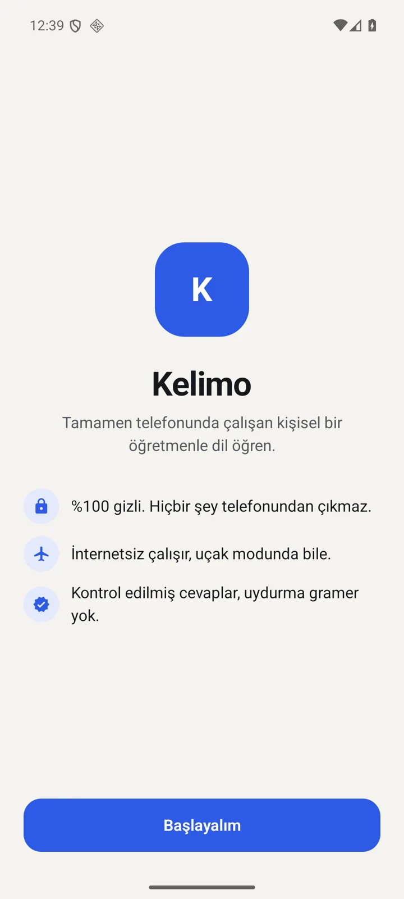
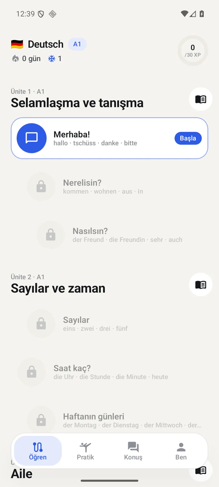
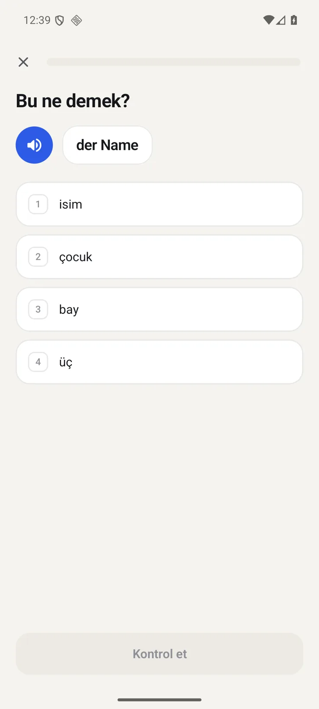
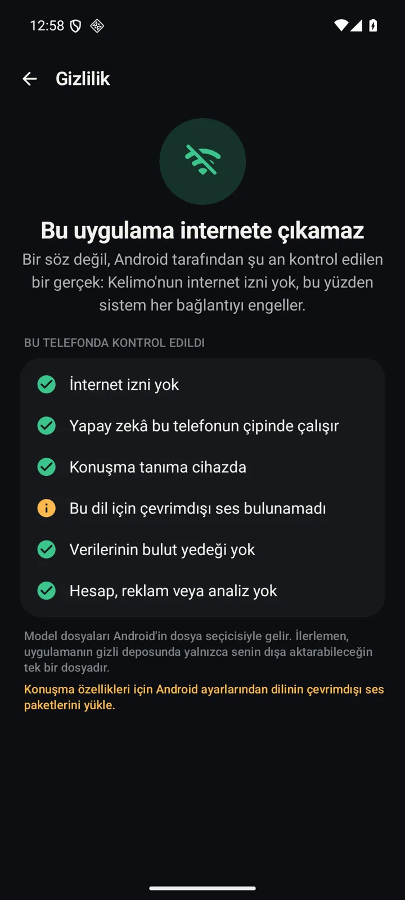
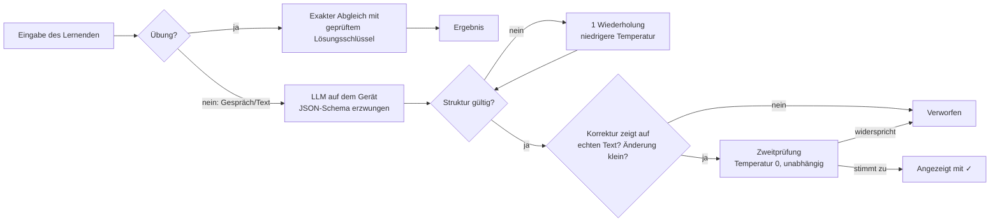

<div align="center">


# Kelimo

**Sprachen lernen mit einem KI-Tutor, der komplett auf deinem Handy läuft.**<br>
Kein Konto. Kein Abo. Kein Server sieht je ein Wort, das du schreibst oder sagst.

[](https://github.com/Emre1001/kelimo/releases/latest/download/kelimo.apk)
[](https://emre1001.github.io/kelimo/)


<br>

 &nbsp;
 &nbsp;
 &nbsp;


</div>

---

## Was ist Kelimo?

Kelimo (von türkisch *kelime*, „Wort“) ist eine Android-App zum Sprachenlernen, gebaut für **Türkischsprachige, die Deutsch lernen** – und offen für 13 Sprachen. Sie verbindet einen von Hand geprüften Kurs mit einem lokalen Sprachmodell (z. B. **Gemma 4**), das auf dem Chip deines Handys läuft. Optimiert für das **Galaxy S25+**, läuft aber auf jedem Android 12+.

| | |
|---|---|
| 🔒 **100 % privat** | KI, Stimme, Spracherkennung und Fortschritt bleiben auf dem Handy. Einzige Verbindung: optionaler Update-Check bei GitHub. |
| 🔄 **Updates in der App** | Neue Version wird angezeigt und per Tipp installiert. Fortschritt bleibt, vorher wird automatisch gesichert. |
| 🔥 **Serien** | Tägliche Serie mit Kalender, Meilensteinen und Serienschutz. |
| 🧠 **Modell frei wählbar** | Jedes `.litertlm`-Modell läuft. Neue Modelle einfach importieren. |
| ✅ **Gegen Halluzinationen gebaut** | Bewertung ohne KI, Schema-gebundene Ausgabe, Faktenprüfung, unabhängige Zweitmeinung. |
| 🎯 **Passt sich an** | Elo-Modell pro Fähigkeit, Spaced Repetition, adaptiver Einstufungstest. |
| 🌗 **Hell & Dunkel** | Folgt automatisch dem System, umschaltbar in den Einstellungen. |

---

## Installieren

1. **APK laden:** [kelimo.apk](https://github.com/Emre1001/kelimo/releases/latest/download/kelimo.apk) auf dem Handy öffnen.
2. **Installieren:** Android fragt einmal, ob der Browser Apps installieren darf. Erlauben.
3. **Setup:** Muttersprache, Zielsprache, Ziel, Niveau. Lektionen laufen sofort.
4. **KI-Modell hinzufügen** (für Gespräche, Schreibcoach, Geschichten): In der App unter *Modelle* auf „Im Browser herunterladen“ tippen, danach „Modell importieren“ und die `.litertlm`-Datei wählen.

<details>
<summary><b>Welches Modell soll ich nehmen?</b></summary>

<br>

| Modell | Größe | RAM | Qualität | Tempo | Hinweis |
|---|---|---|---|---|---|
| **Gemma 4 E4B** | 3,66 GB | 8 GB | ●●●●● | ●●●○○ | **Empfohlen für Galaxy S25+**, stark in Deutsch und Türkisch |
| Gemma 4 E2B | 2,59 GB | 6 GB | ●●●●○ | ●●●●○ | Schneller, gut für den Sprachmodus |
| Qwen3 4B Instruct | 2,66 GB | 6 GB | ●●●●○ | ●●●○○ | Mehrsprachige Alternative |
| Qwen3.5 4B | 2,75 GB | 6 GB | ●●●●○ | ●●●○○ | Gut bei Grammatik-Erklärungen |
| Ministral 3 3B | 2,34 GB | 5 GB | ●●●○○ | ●●●●○ | Gut für Französisch, Spanisch, Italienisch |

Alle Modelle stammen von [huggingface.co/litert-community](https://huggingface.co/litert-community). Jedes neuere LiteRT-LM-Modell kann ebenfalls importiert werden – Kelimo prüft beim Import den Datei-Header (`LITERTLM`).
</details>

<details>
<summary><b>Spracherkennung funktioniert nicht?</b></summary>

<br>

Kelimo nutzt ausschließlich **On-Device-Spracherkennung** (`SpeechRecognizer.createOnDeviceSpeechRecognizer`). Fehlt das Sprachpaket, installiere es unter *Einstellungen › Allgemeine Verwaltung › Sprache › Spracherkennung › Offline-Sprachen* (Samsung) bzw. *Google › Spracherkennung offline*. Eine Cloud-Erkennung wird bewusst **nie** genutzt.
</details>

---

## Funktionen

<details open>
<summary><b>📚 Kurs & Übungen</b></summary>

- Deutsch-Kurs **A1–B1**: 12 Einheiten, 36 Lektionen, **288 Wörter**, **215 Sätze**, 27 Grammatik-Notizen mit Türkisch-Vergleichen (z. B. *„halb drei“ = iki buçuk*, Verb am Satzende wie im Türkischen)
- Englisch-Kurs A1–A2 für Türkisch- und Deutschsprachige
- **11 Übungstypen:** Bedeutung wählen · Wort wählen · Paare finden · Satz aus Kacheln bauen (beide Richtungen) · Lückentext · Diktat · Aussprache · der/die/das · Wort tippen · Verbkonjugation
- Falsche Antworten kommen am Ende der Lektion noch einmal, Combo-Zähler, XP, Serie mit Serienschutz
- Tastaturleiste für ä ö ü ß (und Akzente anderer Sprachen)
</details>

<details>
<summary><b>💬 Sprechen & Gespräche</b></summary>

- **Freihändiger Sprachmodus:** Tutor spricht, hört zu, antwortet – in einer Schleife
- **Sagt dir deine Fehler laut** (Erklärung in deiner Sprache, richtiger Satz in der Zielsprache) und wie es **natürlicher** klingt
- **Auswertung** am Ende: alle Fehler, Tipps und was du als Nächstes üben solltest
- **Stimmen-Auswahl:** alle installierten Offline-Stimmen (Samsung, Google …) zum Anhören und Auswählen
- **12 Rollenspiele** aus dem Alltag in Deutschland: Bäckerei, Café, neue Nachbarin, Arzt, Termin am Telefon, Wohnungsbesichtigung, Bürgeramt, Bahnhof, Vorstellungsgespräch, Elterngespräch, Reklamation, freies Gespräch
- Sanfte Korrekturen mit farbigem Wort-Diff und Erklärung in deiner Sprache
- Übersetzung auf Tipp, Antwortvorschläge, langsame Wiedergabe
</details>

<details>
<summary><b>🛠 Werkzeuge</b></summary>

- **Schreibcoach** mit Aufgaben pro Niveau, markierten Korrekturen und Niveau-Schätzung
- **Geschichten** auf deinem Niveau mit Verständnisfragen
- **Frag die Lehrkraft:** Grammatikfragen, beantwortet auf Basis der Kursnotizen, mit Quellen
- **Wörterbuch:** Kurswörter sofort (mit Artikel, Plural, Beispiel), KI nur auf Wunsch
- **Fehlerheft**, **Meine Wörter** mit Stärke-Anzeige, **Smarte Wiederholung**
- **Einstufungstest** (adaptiv, ~3 Min.)
- Tägliche lokale Erinnerung, Export/Import des Fortschritts als Datei
</details>

---

## Wie Kelimo Halluzinationen verhindert

Kleine On-Device-Modelle machen Fehler. Kelimo ist so gebaut, dass diese Fehler den Lernenden möglichst nie erreichen: **Das Modell schlägt vor, deterministischer Code entscheidet.**



| Stufe | Was passiert | Wo im Code |
|---|---|---|
| Fester Lösungsschlüssel | Übungen werden nie von der KI bewertet. Tippfehler-Toleranz, aber Artikel/Endungen sind nie „nur Tippfehler“. | [`Grader.kt`](app/src/main/java/app/kelimo/learn/Grader.kt) |
| Constrained Decoding | `ResponseFormat.json(schema)` von LiteRT-LM, Fallback auf robuste JSON-Extraktion | [`LlmEngine.kt`](app/src/main/java/app/kelimo/ai/LlmEngine.kt) |
| Faktenprüfung | Fehler im Schreibcoach müssen wörtlich im Originaltext stehen; Story-Fragen brauchen einen Beleg-Satz aus der Geschichte | [`Tutor.kt`](app/src/main/java/app/kelimo/ai/Tutor.kt) |
| Zweite Meinung | Unabhängiger Prüf-Durchlauf (Temperatur 0) muss jeder Korrektur zustimmen | `Tutor.verify()` |
| Sprachprüfung | Antwort in der falschen Sprache wird neu erzeugt | [`Lang.kt`](app/src/main/java/app/kelimo/core/Lang.kt) |
| Ehrliche Labels | Ungeprüfte Inhalte sind als KI markiert, Grammatik-Antworten nennen Quellen | UI |

---

## Datenschutz, technisch belegt

- **Lerndaten verlassen nie das Handy:** Modell, Spracherkennung, Sprachausgabe, Gespräche und Fortschritt laufen lokal.
- **Einzige Netzwerkanfrage:** beim Start fragt [`Updater.kt`](app/src/main/java/app/kelimo/update/Updater.kt) `api.github.com` nach der neuesten Version. Gesendet wird nur diese Anfrage, keine Daten. In den Einstellungen abschaltbar – dann geht die App nie online.
- **Sichere Updates:** Download nur von `github.com`, danach Prüfung von Paketname und Signatur. Passt sie nicht zur installierten App, wird die Datei verworfen.
- **Kein Cloud-Backup** (`allowBackup="false"`), kein Konto, keine Werbung, kein Tracking.
- **Spracherkennung:** zuerst On-Device; fehlt sie, der Android-Sprachdienst mit „offline bevorzugt“. Ein strenger Modus erlaubt nur On-Device.

## Updates & Fortschritt

- Neue Versionen erscheinen als Hinweis in der App und werden per Tipp installiert.
- Alle Versionen sind mit demselben Schlüssel signiert, deshalb installiert Android sie **über** die alte Version: Fortschritt, Modelle und Einstellungen bleiben.
- Vor jedem Update sichert Kelimo den Fortschritt automatisch (`state.backup-v<alt>.json`); wiederherstellbar unter *Einstellungen › Deine Daten*.

## Selbst bauen

```bash
git clone https://github.com/Emre1001/kelimo.git
cd kelimo
./gradlew :app:testDebugUnitTest   # 25 Tests: Bewertung, SRS, Adaptivität, Kurs-Integrität
./gradlew :app:assembleRelease     # app/build/outputs/apk/release/app-release.apk
```

Voraussetzungen: JDK 17, Android SDK 36. Der Kurs liegt als Python-Quelle in [`content/`](content) und wird mit `python3 content/course_de.py` nach `app/src/main/assets/` erzeugt.

<details>
<summary><b>Architektur</b></summary>

```
app/src/main/java/app/kelimo/
├── ai/          LlmEngine (LiteRT-LM), Tutor (Prompts + Prüfungen), Modellkatalog, Rollenspiele
├── course/      Kursmodell + Laden aus assets/
├── learn/       Grader, SRS (SM-2), Adaptive (Elo), Übungsgenerator, Einstufung, Erinnerungen
├── speech/      Offline-TTS und On-Device-Spracherkennung
├── data/        App-Zustand, atomare JSON-Speicherung
└── ui/          Compose: eigenes Designsystem, Navigation mit Predictive Back, Screens
```

- **UI:** Jetpack Compose, eigenes Farbsystem (hell/dunkel), kritisch gedämpfte Federn für alle Übergänge, Haptik, Predictive-Back-Geste mit Vorschau
- **KI:** [LiteRT-LM](https://github.com/google-ai-edge/LiteRT-LM) 0.17.1, GPU mit automatischem CPU-Fallback
- **Speicher:** eine JSON-Datei mit `AtomicFile`, entprellt
</details>

---

## FAQ

<details><summary>Ist Kelimo kostenlos?</summary><br>Ja. Keine Werbung, kein Abo, keine In-App-Käufe. MIT-Lizenz.</details>
<details><summary>Warum ist die App nicht im Play Store?</summary><br>Noch nicht. Die APK aus den Releases ist identisch mit dem Quellcode hier.</details>
<details><summary>Warum lädt die App Modelle nicht selbst herunter?</summary><br>Dafür bräuchte sie die Internet-Berechtigung. Ohne sie kann sie technisch nichts senden – das ist der Kern des Datenschutzversprechens.</details>
<details><summary>Kann ich andere Sprachen lernen?</summary><br>Ja: Deutsch und Englisch mit geprüftem Kurs; Spanisch, Französisch, Italienisch, Niederländisch, Portugiesisch, Polnisch, Russisch, Ukrainisch, Arabisch, Japanisch und Türkisch mit KI-Lektionen, Gesprächen und Rollenspielen.</details>

---

<div align="center">
<sub>Gebaut mit Kotlin, Jetpack Compose und LiteRT-LM · <a href="https://emre1001.github.io/kelimo/">emre1001.github.io/kelimo</a></sub>
</div>
